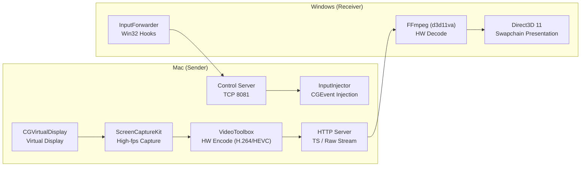

# MacScreenExtender — High-Performance Wireless Second Display for Mac ↔ Windows / iPad

[简体中文](README.md) | English

<p align="center">
  <b>Turn any Windows PC or iPad into an ultra-low-latency wireless extended display for your Mac</b><br>
  Full GPU hardware-accelerated encode/decode · Adaptive 60/120fps high refresh · Zero-latency local cursor · No Apple ID restrictions · 4K HiDPI ready
</p>

<p align="center">
  
</p>

---

## ✨ Features

- 🖥️ **True virtual extended display**: The Mac side creates a real second virtual display whose resolution and refresh rate (60Hz / 120Hz supported) natively match the Windows / iPad display.
- ⚡ **End-to-end GPU pipeline**:
  - **Mac sender**: ScreenCaptureKit frame capture + VideoToolbox hardware encoding (H.264 / HEVC);
  - **Windows receiver**: FFmpeg `d3d11va` hardware decoding + Direct3D 11 flip-model swapchain presentation, CPU usage only 1%–5%;
  - **iPadOS receiver**: Native `AVSampleBufferDisplayLayer` zero-copy hardware decoding, latency as low as 5–15 ms, with gesture and Apple Pencil support.
- 🍏 **No Apple ID Sidecar restrictions**: Works with any Apple ID (great for corporate-managed Macs + personal iPads) and older iPad models that never officially supported Sidecar.
- 🖱️ **Zero-latency cursor**: The pointer is rendered locally by the receiver — no drifting or stuttering caused by video network latency.
- ⌨️ **Bidirectional control**: Windows keyboard/mouse or iPad touch / Apple Pencil smoothly control the Mac, with smooth scrolling and dynamic gesture mapping.
- 🎨 **Modern native card UI**: Clean light card design, native Windows `PerMonitorV2` high-DPI support (100%–200% scaling) and a modern native iPadOS design.
- 📡 **LAN auto-discovery & 4-digit pairing**: Zero-config device discovery via UDP LAN broadcast; first connection pairs with a random 4-digit code that generates a persistent token, preventing unauthorized screen peeking on the LAN.
- 🍎 **Ready-to-distribute notarized builds**: Supports Apple Developer ID signing with official Notarization & Stapling, producing a DMG that installs with a double-click on any Mac.

---

## 💻 System Requirements

| Side | OS requirement | Recommended hardware |
|---|---|---|
| **Mac (sender)** | macOS 13.0 (Ventura) or later | Apple Silicon (M1/M2/M3/M4) |
| **Windows (receiver)** | Windows 10 / 11 64-bit | DirectX 11 capable GPU, .NET 8 Desktop Runtime |
| **iPad (receiver)** | iPadOS 16.0 or later | Any iPad (different Apple ID / older models supported) |
| **Android tablet (receiver)** | Android 9.0 or later | 2019+ tablets, 5GHz Wi-Fi (code ready, real-device testing pending, see [`android-receiver/`](android-receiver/README.md)) |
| **Network** | Same LAN | 5GHz Wi-Fi, Wi-Fi 6, or gigabit Ethernet recommended |

---

## 📥 Download & Install

**No building required for regular users** — grab the latest release for your platform from the [**Releases page**](https://github.com/alan8182/MacScreenExtender/releases):

| File | Platform | Notes |
|---|---|---|
| `MacScreenSender.dmg` | Mac (sender) | Signed + Apple notarized; download, double-click, install — no security prompts |
| `MacScreenReceiver-win64.zip` | Windows (receiver) | Unzip and run, no installer; requires [.NET 8 Desktop Runtime (x64)](https://dotnet.microsoft.com/download/dotnet/8.0) |
| Source code | iPad / Android (receiver) | See [`ipad-receiver/`](ipad-receiver/README.md) and [`android-receiver/`](android-receiver/README.md); build with Xcode / Android Studio |

> 💡 On first launch Windows may show a **SmartScreen** warning because the binary is not code-signed — click **"More info" → "Run anyway"**. The Windows package bundles the FFmpeg runtime (LGPL, dynamically linked, unmodified).
>
> 🛠️ Developers can skip downloads and build from source directly — see "Build & Release" below.

---

## 🚀 Quick Start

### 1. Mac (sender)
- Launch `MacScreenSender.app`;
- On first run, grant **Screen Recording** and **Accessibility** (reverse keyboard/mouse control) permissions in **System Settings → Privacy & Security**;
- The app lives in the menu bar and shows the **4-digit pairing code** for connecting.

### 2. Windows (receiver)
- Unzip and run `MacScreenReceiver.exe`;
- It auto-discovers Macs on the LAN — click **“连接 / Connect”**;
- Enter the 4-digit pairing code shown in the Mac's menu bar on first connection;
- Full-screen extended display mode starts as soon as the first frame arrives!

### 3. iPad (receiver)
- See [`ipad-receiver/README.md`](ipad-receiver/README.md);
- Open `ipad-receiver/MacScreenReceiver-iPad.xcodeproj` in Xcode and run it on your iPad;
- Auto-discovers the Mac on the LAN — enter the pairing code and enjoy an ultra-low-latency touch display!

### 4. Keyboard shortcuts (Windows)
| Shortcut | Action |
|---|---|
| <kbd>Esc</kbd> | Exit fullscreen back to the settings panel (press again in windowed mode to quit) |
| <kbd>F11</kbd> | Toggle fullscreen / windowed |
| <kbd>F1</kbd> or <kbd>Ctrl</kbd>+<kbd>I</kbd> | Toggle live connection diagnostics (resolution, codec, network & render latency) |

---

## 🛠️ Build & Release

### Mac sender

#### Daily development & debugging:
```bash
# Detects local certificates automatically, packages and installs to /Applications
./build-app.sh
```

#### Official release (signing + Apple notarization + DMG):
```bash
# Full pipeline: signing, DMG assembly, Apple notarization, ticket stapling
./release-mac.sh
```
> Output: `build/MacScreenSender.dmg`. For the complete release handbook (versioning, notarization setup, post-release verification), see [RELEASE.md](RELEASE.md).

### Windows receiver

```bash
cd windows-receiver
# Release build for win-x64
dotnet publish -c Release -r win-x64 -o publish

# Run the GPU pipeline regression self-check
python3 check_gpu_pipeline.py
```
> Output goes to `windows-receiver/publish/`, including the Direct3D 11 and FFmpeg runtimes.

---

## 📐 Architecture

For data/control flow design details and lessons learned, see [ARCHITECTURE.md](ARCHITECTURE.md).



---

## 📄 License & Disclaimer

- This project is released under the [MIT License](LICENSE).
- **Disclaimer**: The Mac virtual display implementation uses the macOS private SPI (`CGVirtualDisplay`), so it cannot be distributed on the Mac App Store — but it fully complies with Apple Developer ID notarization and external distribution requirements.
