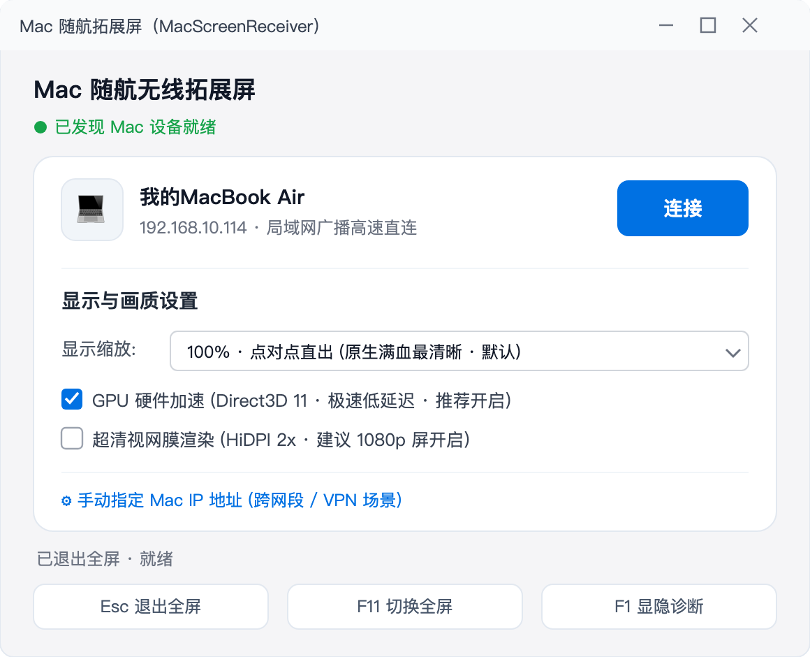
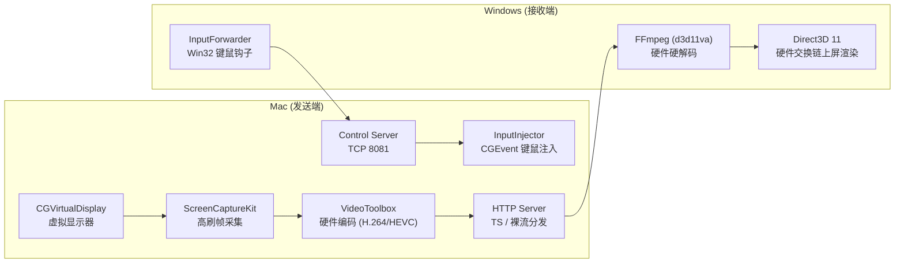

# MacScreenExtender — Mac ↔ Windows / iPad 高性能无线扩展屏

简体中文 | [English](README.en.md)

<p align="center">
  <b>把任意一台 Windows 电脑或 iPad 秒变 Mac 的超低延迟无线扩展屏</b><br>
  全 GPU 硬件加速编解码 · 60/120fps 自适应高刷 · 控制端光标 0ms 跟手 · 突破 Apple ID 限制 · 4K 高分屏自适应
</p>

<p align="center">
  
</p>

---

## ✨ 核心特性

- 🖥️ **原生虚拟扩展屏**：Mac 端创建真实存在的第二块虚拟显示器，分辨率与刷新率（支持 60Hz / 120Hz）自动与 Windows / iPad 显示器原生匹配。
- ⚡ **端到端全 GPU 渲染流水线**：
  - **Mac 发送端**：ScreenCaptureKit 帧采集 + VideoToolbox 硬件编码（H.264 / HEVC）；
  - **Windows 接收端**：FFmpeg `d3d11va` 硬件解码 + Direct3D 11 硬件交换链合成上屏，CPU 占用仅 1%~5%；
  - **iPadOS 接收端**：原生 `AVSampleBufferDisplayLayer` 零拷贝硬件硬解，延迟低至 5~15ms，支持手势与 Apple Pencil。
- 🍏 **突破 Apple ID 随航壁垒**：iPad 端支持任意账号（特别适合公司 Mac 企业号 + 个人 iPad）、支持老款不支持官方随航的 iPad 机型。
- 🖱️ **光标 0ms 跟手**：控制端指针由接收端本地渲染，无视频网络延迟带来的漂移与卡顿感。
- ⌨️ **双端反向控制**：Windows 键鼠 / iPad 触控及 Apple Pencil 平滑控制 Mac，支持平滑滚动与动态手势映射。
- 🎨 **现代原生极简卡片 UI**：全新浅色卡片视觉设计，原生支持 Windows `PerMonitorV2` 高 DPI 规范（100%~200% 等比缩放）与 iPadOS 现代原生设计。
- 📡 **局域网自动发现与 4 位配对鉴权**：UDP 局域网广播零配置发现设备，首次连接 4 位随机配对码握手生成持久化令牌，防局域网未授权窥屏。
- 🍎 **开箱即用公证分发**：支持使用 Apple 官方 Developer ID 签名并完成安全公证（Notarization & Stapling），生成任何 Mac 均可直接双击安装运行的 DMG 安装包。

---

## 💻 系统要求

| 端 | 系统环境要求 | 硬件建议 |
|---|---|---|
| **Mac (发送端)** | macOS 13.0 (Ventura) 及更高版本 | Apple Silicon (M1/M2/M3/M4 系列芯片) |
| **Windows (接收端)** | Windows 10 / 11 64-bit | 支持 DirectX 11 显卡，.NET 8 Desktop Runtime |
| **iPad (接收端)** | iPadOS 16.0 及更高版本 | 支持任意 iPad（支持不同 Apple ID / 老款 iPad） |
| **Android 平板 (接收端)** | Android 9.0 及更高版本 | 2019 年后平板、支持 5GHz Wi-Fi（代码就绪待真机联调，见 [`android-receiver/`](android-receiver/README.md)） |
| **网络环境** | 同一局域网内通信 | 建议 5GHz Wi-Fi、Wi-Fi 6 或千兆有线网络 |

---

## 📥 下载安装

**普通用户无需编译**，前往 [**Releases 页面**](https://github.com/alan8182/MacScreenExtender/releases) 下载对应平台的最新版：

| 文件 | 平台 | 说明 |
|---|---|---|
| `MacScreenSender.dmg` | Mac（发送端） | 已签名 + 苹果官方公证，下载后双击安装，无安全阻拦 |
| `MacScreenReceiver-win64.zip` | Windows（接收端） | 解压即用，无需安装；需预装 [.NET 8 Desktop Runtime (x64)](https://dotnet.microsoft.com/download/dotnet/8.0) |
| 源码 | iPad / Android（接收端） | 见 [`ipad-receiver/`](ipad-receiver/README.md) 与 [`android-receiver/`](android-receiver/README.md)，分别用 Xcode / Android Studio 构建安装 |

> 💡 Windows 端首次运行若弹出 **SmartScreen「已保护你的电脑」**提示，属未签名程序的正常现象：点击 **「更多信息」→「仍要运行」** 即可。Windows 包内含 FFmpeg 运行时（LGPL，动态链接，未做修改）。
>
> 🛠️ 开发者可跳过下载，直接从源码构建，见下方「构建与发布」。

---

## 🚀 快速上手

### 1. Mac 端（发送端）
- 启动 `MacScreenSender.app`；
- 首次运行时，在 **系统设置 → 隐私与安全性** 中按提示授予 **屏幕录制** 与 **辅助功能**（键鼠反向控制）权限；
- 启动后常驻顶部菜单栏，菜单中会显示用于连接的 **4 位配对码**。

### 2. Windows 端（接收端）
- 解压并运行 `MacScreenReceiver.exe`；
- 程序将自动扫描发现局域网内的 Mac，点击 **“连接”**；
- 首次连接时输入 Mac 菜单栏显示的 4 位配对码；
- 收到首帧画面后自动进入全屏扩展屏模式！

### 3. iPad 端（接收端）
- 详见 [`ipad-receiver/README.md`](ipad-receiver/README.md)；
- 使用 Xcode 打开 `ipad-receiver/MacScreenReceiver-iPad.xcodeproj` 直接运行到 iPad 上；
- 自动发现局域网 Mac，输入配对码即可享受超低延迟触控扩展屏！

### 4. 常用控制快捷键（Windows 端）
| 快捷键 | 功能说明 |
|---|---|
| <kbd>Esc</kbd> | 退出全屏返回设置面板（窗口模式下再按关闭程序） |
| <kbd>F11</kbd> | 切换 全屏 / 窗口化 模式 |
| <kbd>F1</kbd> 或 <kbd>Ctrl</kbd>+<kbd>I</kbd> | 显隐实时连接诊断信息（分辨率、编码格式、网络与渲染延迟） |

---

## 🛠️ 构建与发布

### Mac 端构建

#### 日常开发与调试：
```bash
# 自动检测本地证书并打包安装到 /Applications
./build-app.sh
```

#### 官方商业化发布（签名 + 苹果官方公证 + DMG 打包）：
```bash
# 执行完整签名、DMG 组装、苹果官方公证并自动装订票据
./release-mac.sh
```
> 发布产物位于 `build/MacScreenSender.dmg`。完整发版手册（版本号规范、公证配置、发布后验证）见 [RELEASE.md](RELEASE.md)。

### Windows 端构建

```bash
cd windows-receiver
# 发布 win-x64 Release 版本
dotnet publish -c Release -r win-x64 -o publish

# 执行 GPU 渲染管线回归自检
python3 check_gpu_pipeline.py
```
> 发布包位于 `windows-receiver/publish/`，包含 Direct3D 11 与 FFmpeg 运行时。

---

## 📐 技术架构

数据流、控制流架构设计与踩坑记录详见 [ARCHITECTURE.md](ARCHITECTURE.md)。



---

## 📄 开源许可与免责声明

- 本项目基于 [MIT License](LICENSE) 开源。
- **免责声明**：Mac 端虚拟屏实现调用了 macOS 私有 SPI（`CGVirtualDisplay`），因此无法上架 Mac App Store，但完全符合通过 Apple Developer ID 进行独立公证与外部安全分发的要求。
